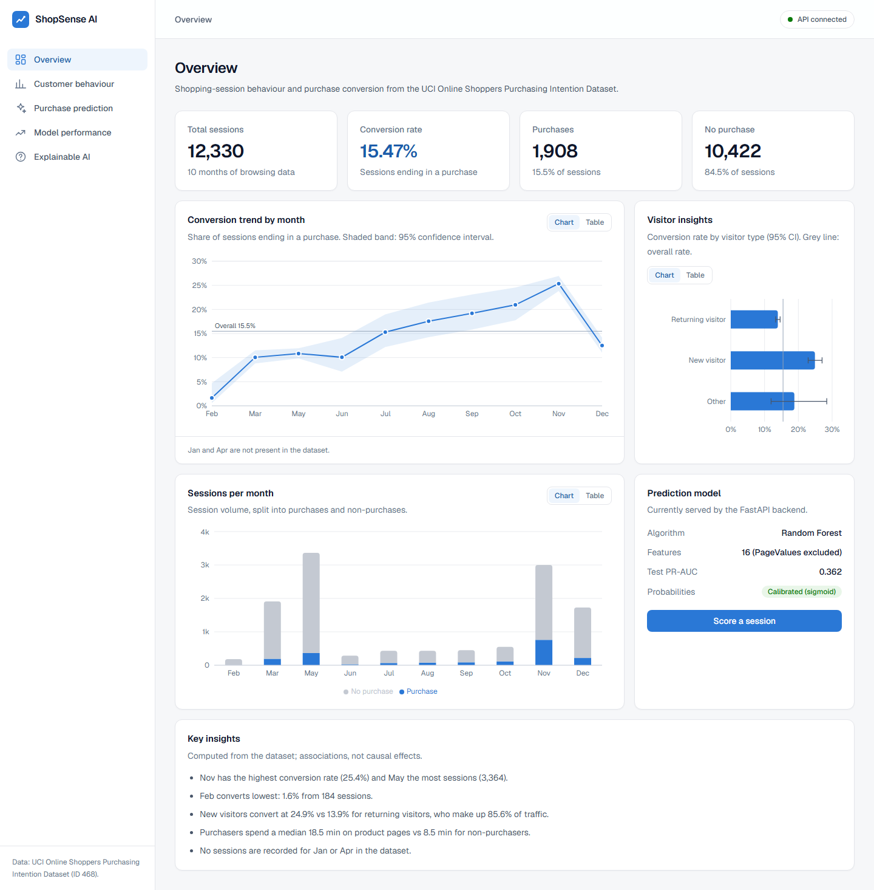
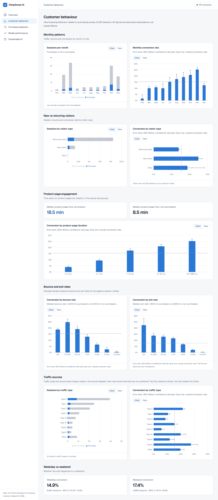
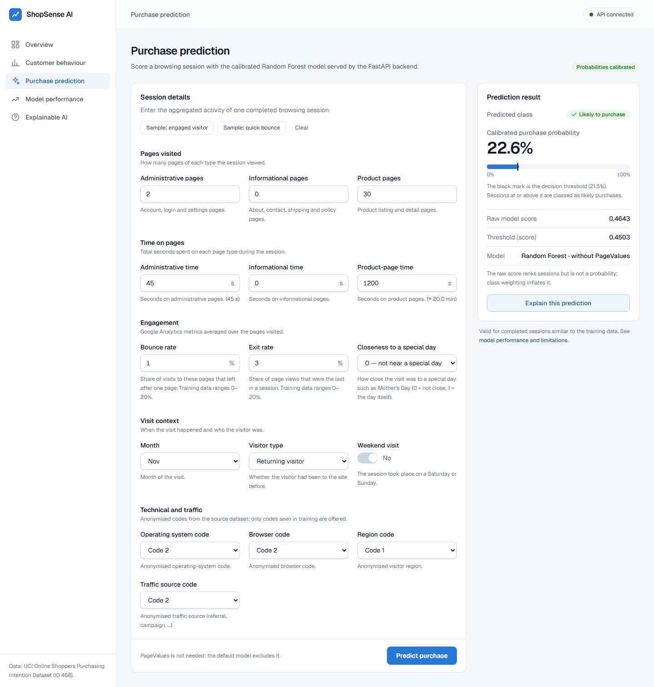
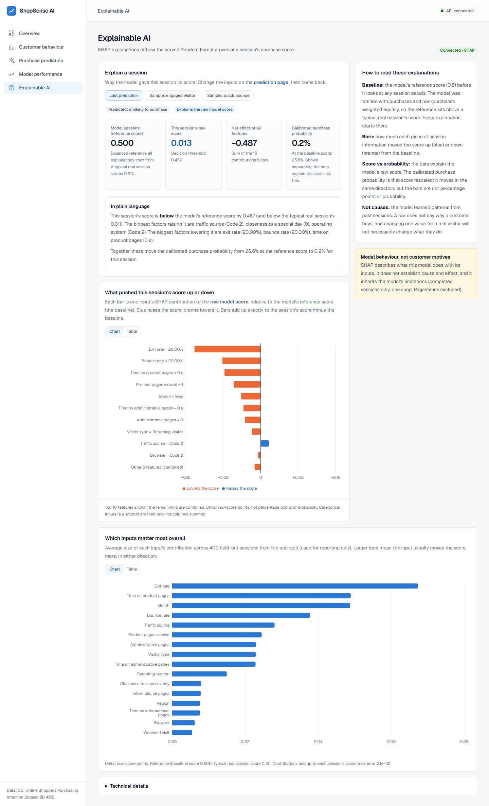
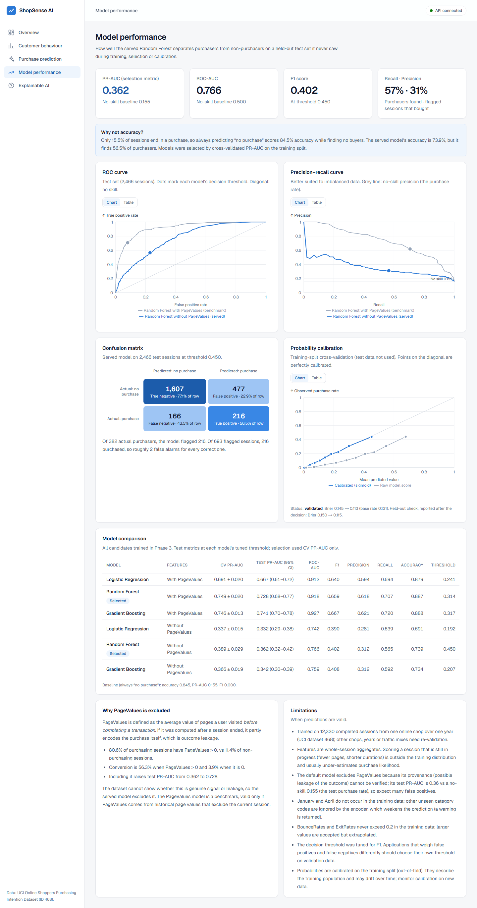
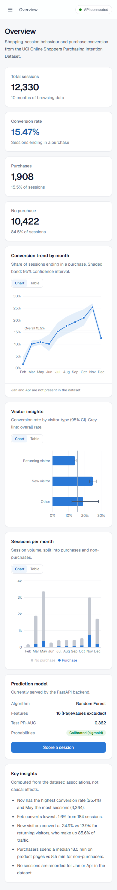
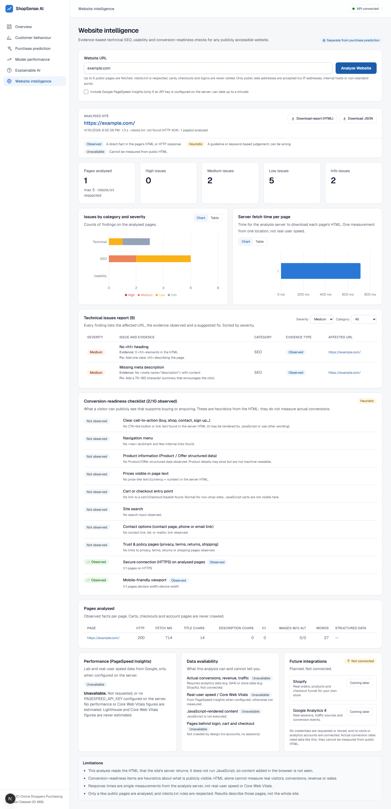
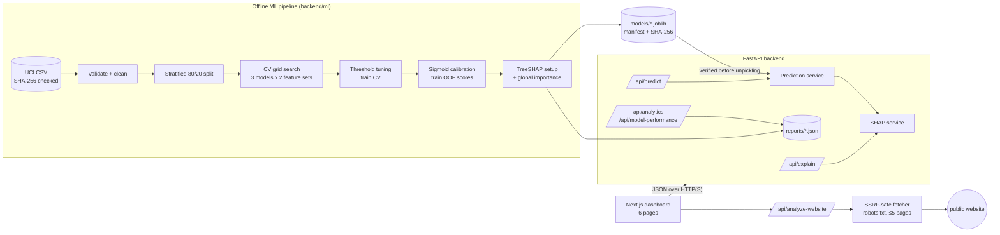

# ShopSense AI

**Predicting whether an online shopping session ends in a purchase, with calibrated
probabilities and SHAP explanations, served through a FastAPI backend and a Next.js analytics
dashboard.**

Built on the [UCI Online Shoppers Purchasing Intention Dataset](https://archive.ics.uci.edu/dataset/468/online+shoppers+purchasing+intention+dataset)
(12,330 sessions, 15.47% purchases).

- **End-to-end data science:** validation → EDA → leakage-safe pipelines → CV model selection →
  threshold tuning → probability calibration → explainability → API → dashboard.
- **Honest modelling:**
  - A suspected leakage feature (`PageValues`) is excluded from the served model, with a benchmark
    model showing what it would add.
  - Models are selected by PR-AUC, not accuracy.
  - The test set was used only for final reporting.
- **Trustworthy outputs:**
  - Probabilities are shown only when calibration passes acceptance criteria fixed in advance.
  - SHAP contributions are verified to add up to the score on every request.
  - Model files are checksum-verified before loading.
- **Website Intelligence:** an evidence-based audit of any public website. It covers technical
  issues, SEO, usability and conversion readiness. It is SSRF-safe and respects robots.txt.
  Every finding is labelled as observed or heuristic, and nothing is invented.
- **Verified:**
  - backend tests, frontend unit tests, and browser checks in Edge, Chrome and Firefox (including
    an automated accessibility audit);
  - dashboard numbers re-derived from the raw CSV;
  - a clean rebuild that reproduces every reported metric.

> **Status:** complete for portfolio and coursework. **Not deployed.** See [DEPLOYMENT.md](DEPLOYMENT.md) for options.

---

## Screenshots

| Overview | Customer behaviour |
|---|---|
|  |  |
| **Purchase prediction** (calibrated probability) | **Explainable AI** (SHAP) |
|  |  |
| **Model performance** | **Mobile** |
|  |  |
| **Website intelligence** (real analysis of example.com) | |
|  | |

---

## Results

All figures are from the held-out test split (2,466 sessions, stratified, scored once after
model selection). Sources: [`model_results.json`](backend/reports/model_results.json) and
[`calibration_results.json`](backend/reports/calibration_results.json).

| Model | PR-AUC | ROC-AUC | F1 | Precision | Recall | Accuracy |
|---|---|---|---|---|---|---|
| **Served: Random Forest, without PageValues** | **0.362** | **0.766** | **0.402** | 0.312 | 0.565 | 0.739 |
| Benchmark: Random Forest, with PageValues | 0.728 | 0.918 | 0.659 | 0.618 | 0.707 | 0.887 |
| Baseline: always "no purchase" | 0.155 | 0.500 | 0.000 | 0.000 | 0.000 | **0.845** |

- **Why not accuracy?** The do-nothing baseline scores 0.845 accuracy and finds no buyers. The
  served model finds **56.5% of purchasers**.
- **Why exclude PageValues?** It doubles PR-AUC, but it is defined from pages viewed *before a
  completed transaction*, so it may encode the outcome. The dataset cannot rule that out.
  Details: [MODEL_REPORT.md §4](backend/reports/MODEL_REPORT.md).
- **Calibration (served model):**
  - Before: raw scores over-state purchase likelihood (training-CV Brier 0.145, worse than the
    0.131 of always predicting the base rate).
  - Fix: a sigmoid calibrator fitted on training data only.
  - After: Brier **0.113**, calibration error **0.006** (held-out check: Brier 0.115).
- **Explainability:** exact TreeSHAP, with additivity error ≤ 2×10⁻¹² on 400 held-out sessions.
  The most influential inputs are **exit rate, time on product pages, month and bounce rate**.
  Details: [EXPLAINABILITY.md](backend/reports/EXPLAINABILITY.md).

Full model comparison (Logistic Regression, Random Forest and Gradient Boosting, each with and
without PageValues): [MODEL_REPORT.md](backend/reports/MODEL_REPORT.md).

---

## Architecture



| Layer | Technology | Responsibility |
|---|---|---|
| Frontend | Next.js 16 (App Router), TypeScript, Tailwind CSS 4, Recharts 3 | Dashboard, prediction form, SHAP charts, loading/error states, chart ↔ table toggle |
| Backend | Python 3.13, FastAPI, Pydantic v2, Uvicorn | Strictly validated JSON API, CORS, security headers, explanation rate limiting |
| ML | pandas, NumPy, scikit-learn 1.9.1, SHAP 0.54.1 | Pipelines, model selection, calibration, explanations |
| Analysis | Matplotlib, Seaborn, SciPy | EDA figures and statistical tests |

---

## Machine learning pipeline

1. **Data:** downloaded from UCI over verified TLS. The SHA-256 is checked, and the file is never
   modified. Validation covers schema, types, ranges and labels.
2. **Split:** stratified 80/20 (`random_state=42`). The test split is held out until the end.
3. **Leakage-safe preprocessing:** a scikit-learn `ColumnTransformer` (median imputation, `log1p`,
   scaling, one-hot encoding) inside each `Pipeline`, refitted within every CV fold.
4. **Model selection:** stratified 5-fold CV on the training split, choosing by **PR-AUC**.
   Candidates are Logistic Regression, Random Forest and Gradient Boosting, each with and without
   PageValues.
5. **Class imbalance (15.5% positives):** stratification, CV-tuned class weights, and an F1-tuned
   decision threshold (training CV).
6. **Calibration:** out-of-fold training scores, with sigmoid vs isotonic compared by a second CV.
   Acceptance criteria were fixed in advance; if they fail, the API returns a score, not a
   probability.
7. **Explanations:** exact TreeSHAP on the same fitted pipeline. One-hot columns are summed back to
   their 16 inputs. SHAP explains the **raw score**; calibrated probabilities are shown separately.

---

## Website Intelligence

Open `/website-intelligence`, enter a domain or URL (for example `example.com`), and choose
**Analyze Website**. The backend then:

1. **Validates the URL:** public `http`/`https` on ports 80 and 443 only. It rejects IP literals,
   credentials in the URL, and internal host names. It resolves DNS once and requires **every**
   address to be public, which blocks private, loopback, metadata (169.254.169.254) and CGNAT
   addresses, and IPv4 hidden inside IPv6. It connects only to the address it checked (no DNS
   rebinding) and re-checks every redirect.
2. **Reads robots.txt** (RFC 9309) and honours it on every hop, including `Crawl-delay`.
3. **Fetches at most 5 HTML pages:** the home page plus product, shop, pricing and contact pages
   first. Cart, checkout and login pages are never fetched. Each request has timeouts and a 2 MB
   size cap.
4. **Reports:**
   - technical, SEO and usability **issues** with severity, URL, evidence and a recommended fix;
   - a 10-item **conversion-readiness checklist**;
   - charts, and a pages table;
   - downloadable **HTML** (script-free, with a CSP) and **JSON** reports.

**Honesty rules:**
- Every finding is labelled **observed** (a fact from the HTML or HTTP response) or **heuristic**
  (a pattern match that can be wrong).
- Anything public HTML cannot show is listed as **unavailable**: real conversions and traffic,
  Core Web Vitals, and content rendered by JavaScript.
- Lighthouse or Core Web Vitals figures appear only if a Google PageSpeed Insights key is
  configured. They are never estimated.
- Shopify and GA4 appear as disabled "Coming later" items. No credentials are requested or
  stored.
- Purchase prediction is unchanged and separate.

**Abuse limits (defaults):** 10 analyses per client IP per 10 minutes, and 2 running at once. Both
return HTTP 429 with `Retry-After`. Details: [backend/API.md](backend/API.md#post-apianalyze-website-website-intelligence-phase-8).

---

## Getting started (Windows PowerShell)

**Prerequisites:** Python 3.13, Node.js 24 / npm 11, Git.

A fresh clone does **not** contain the dataset or the trained model files; both are git-ignored.
The pipeline below recreates them deterministically. A clean rebuild reproduces every committed
report exactly.

### 1. Backend: environment, data and models (~10 min)

```powershell
cd backend
python -m venv .venv
.\.venv\Scripts\Activate.ps1          # if blocked: Set-ExecutionPolicy -Scope CurrentUser RemoteSigned
pip install -r requirements-dev.txt
python -I ml/download_data.py         # official UCI dataset (checksum verified)
python -m ml.train                    # models + reports/model_results.json (~5-7 min)
python -m ml.calibration              # validated probability calibration
python -m ml.explain                  # SHAP setup + global importance
python -m ml.dashboard_data           # numbers shown in the dashboard
python -m ml.integrity                # verify model-file checksums
```

### 2. Frontend

```powershell
cd frontend
npm ci
Copy-Item .env.example .env.local     # optional; defaults to http://localhost:8000
```

### 3. Run (two terminals)

```powershell
# terminal 1
cd backend; .\.venv\Scripts\Activate.ps1; uvicorn app.main:app --reload --port 8000
# terminal 2
cd frontend; npm run dev              # open the URL it prints (usually http://localhost:3000)
```

The API docs are at http://localhost:8000/docs (development only).

---

## Testing and verification

| Command | What it checks | Result |
|---|---|---|
| `cd backend; pytest` | Preprocessing, training, calibration, API, dashboard, SHAP, security, 82 Website Intelligence tests (SSRF cases, redirects, DNS pinning, size/gzip/timeout limits, robots.txt, crawl limits, checks, rate limits) and 16 deployment tests (verified model download, API rate limit, HSTS, production CORS) | **228 passed** |
| `cd frontend; npm test` | Formatting, form validation, API payload conversion, report export escaping (Node's built-in test runner) | **16 passed** |
| `npm run typecheck`, `npm run lint`, `npm run build` | TypeScript, ESLint, production build | all pass |
| `node tools/verify_ui.mjs …` | 6 pages × 4 widths, navigation, form, SHAP flow, user journey, **axe-core WCAG 2.1 AA** | **97/97** in Edge; 0 axe violations |
| `node tools/verify_firefox.mjs …` | Page loads, prediction, SHAP, Website Intelligence flow, mobile layout in Firefox (WebDriver BiDi) | **15/15** |
| `node tools/verify_website_ui.mjs …` | URL input → real analyses (example.com, python.org) → UI matches the data → filters → HTML/JSON downloads → axe → mobile | **18/18** in Edge and in Chrome |
| `python ..\tools\verify_rate_limits.py` | **Default** production limits: concurrency `[200, 200, 429]`, 429 at request #11, prediction unaffected | **0 failures** |
| `python tools\verify_deployment.py --api … --web …` | Live deployment: HTTPS/HSTS, all endpoints, CORS, SSRF refusals, a real analysis, all six pages | **28/28** on a local Render/Vercel simulation |
| `python ..\tools\verify_dashboard_data.py` | Dashboard numbers vs the raw CSV (independent pandas) and the reports | **148 checks, 0 failures** |
| `python ..\tools\verify_predictions.py` | Live API on all 2,466 test sessions vs saved model + calibrator; metrics reproduce Phase 3 exactly; SHAP additivity | **0 failures** |

The browser tools need the servers running. See [tools/README.md](tools/README.md).

---

## API

| Method | Path | Purpose |
|---|---|---|
| GET | `/health` | Liveness |
| POST | `/api/predict` | Calibrated purchase probability, raw score and class for one session (16 validated inputs) |
| POST | `/api/explain` | SHAP contributions to the raw score, plus the unchanged prediction |
| GET | `/api/model-info` | Model, threshold, calibration status, input schema, limitations |
| GET | `/api/explain/global` | Global feature importance |
| GET | `/api/analytics`, `/api/model-performance` | Dashboard data |
| POST | `/api/analyze-website` | Website Intelligence audit of a public URL (rate-limited) |

Full reference with request and response examples: [backend/API.md](backend/API.md).

---

## Deployment

Prepared but **not deployed**. The planned setup is the backend on **Render** (`render.yaml`) and
the frontend on **Vercel** (root directory `frontend`). The model files come from a GitHub Release
and are checksum-verified at build time. [DEPLOYMENT.md §7](DEPLOYMENT.md#7-render--vercel-step-by-step)
has the step-by-step guide. DEPLOYMENT.md also covers:
- hosting options (Vercel or any Node host for the frontend; container platforms or a VM for the API);
- model-artifact storage with checksum verification;
- environment variables and measured resource needs (~260 MB RAM);
- a production checklist;
- Dockerfiles and `docker-compose.yml` (written, **not built**: Docker was not available on the
  development machine).

---

## Security

- **Input validation:** strict Pydantic validation (types, ranges, known labels); unknown fields
  are rejected, including the target.
- **Model loading:** pickled artifacts are checksum-verified **before** loading, with path-traversal
  checks. The Docker build fails on any mismatch.
- **CORS:** minimal — no credentials, only GET/POST, only the `Content-Type` header. Localhost
  wildcards apply in development only.
- **Production defaults:** API docs off. Security headers on both the API and the frontend. Error
  responses never include server paths.
- **Abuse protection (production):**
  - Each client IP gets 120 requests per minute on the model and dashboard endpoints.
  - Explanation concurrency is capped.
  - Website analysis has its own per-IP and per-process limits.
  - All of these return HTTP 429.
  - Client IPs are taken from the proxy's `X-Forwarded-For` only for trusted proxy ranges, so they
    cannot be spoofed.
- **HTTPS:** HSTS on both the API and the frontend in production.
- **Outbound requests (Website Intelligence):**
  - SSRF-safe: only public IPs, with the connection pinned to the checked IP and every redirect
    re-validated;
  - robots.txt honoured;
  - fixed limits on pages, size, time and redirects;
  - the HTML export escapes all site content and has no scripts.
- **No secrets required:** no database or accounts. The only optional key, `PAGESPEED_API_KEY`,
  stays on the server. `.env` files are git-ignored.
- **Dependencies:** `pip-audit` reports no known vulnerabilities. `npm audit` reports 0 in production
  dependencies; 8 moderate findings are in the dev-only ESLint toolchain (`minimatch`), with no
  non-breaking fix.

---

## Limitations and responsible use

- **Moderate accuracy:** about 2 in 3 sessions flagged as likely buyers do not buy (precision
  0.31). Use it for prioritising and analysis, not for automated decisions about individuals.
- **Completed sessions only:** features are whole-session totals, so scoring a session in progress
  usually underestimates purchase likelihood.
- **One shop, one year:** January and April are absent, and traffic, OS and browser codes are
  anonymised. Re-validate before any other use.
- **SHAP is not causal:** it describes how the model uses inputs, not why customers buy.
  Correlated inputs (page counts and time on those pages) share credit non-uniquely.
- **Calibration can drift:** monitor it on new data.
- **Website Intelligence reads server HTML only:**
  - It does not run JavaScript.
  - It checks at most 5 pages.
  - Fetch times are single measurements from the server, not real-user speed.
  - Conversion-readiness items are visible signals, not measured conversions.

---

## Project structure

```
shopsense-ai/
├── backend/
│   ├── app/            FastAPI app (config, schemas, routes, prediction + SHAP services,
│   │                   website/ = SSRF-safe fetcher, robots, HTML checks, PageSpeed)
│   ├── ml/             data download, preprocessing, EDA, training, calibration, SHAP, integrity
│   ├── models/         model_manifest.json (checksums); *.joblib are git-ignored
│   ├── reports/        EDA, model, calibration and SHAP reports + JSON consumed by the dashboard
│   ├── tests/          pytest suite
│   ├── API.md          API reference
│   ├── Dockerfile      production image (integrity-gated)
│   └── requirements*.txt   full / dev / API-only (pinned)
├── frontend/
│   ├── src/app/        6 routes: /, /analytics, /predict, /performance, /explainability,
│   │                   /website-intelligence
│   ├── src/components/ layout, views, charts, prediction form, UI primitives
│   ├── src/lib/        API client, types, formatting (+ unit tests)
│   └── Dockerfile
├── tools/              verification scripts (UI, Firefox, website UI, rate limits, dashboard data, live predictions)
├── docs/screenshots/
├── docker-compose.yml
├── DEPLOYMENT.md
└── README.md
```

Reports: [EDA_SUMMARY.md](backend/reports/EDA_SUMMARY.md) ·
[MODEL_REPORT.md](backend/reports/MODEL_REPORT.md) ·
[EXPLAINABILITY.md](backend/reports/EXPLAINABILITY.md) · [API.md](backend/API.md)

---

## Dataset and citation

Sakar, C. O., Polat, S. O., Katircioglu, M., & Kastro, Y. (2019). *Real-time prediction of online
shoppers' purchasing intention using multilayer perceptron and LSTM recurrent neural networks.*
Neural Computing and Applications, 31, 6893–6908. Dataset: UCI Machine Learning Repository,
ID 468, licensed **CC BY 4.0**.

No licence has been chosen for this project's code yet. Add a `LICENSE` file before publishing.
